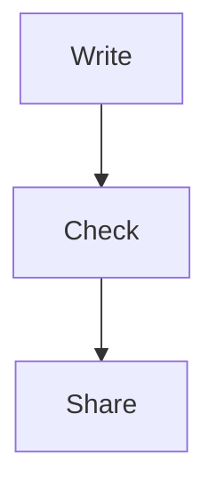

# Field Guide

A short document for trying marqora-cli on. Some of its mistakes are on purpose.

## Getting started

Read [the setup notes](Setup.md) first, then [the glossary](Glossary.md).

## Steps

3. Open the document
7. Pick a color theme
9. Share it as a Folio

## The flow

## Questions

The [steps](#step) above cover most of them.
