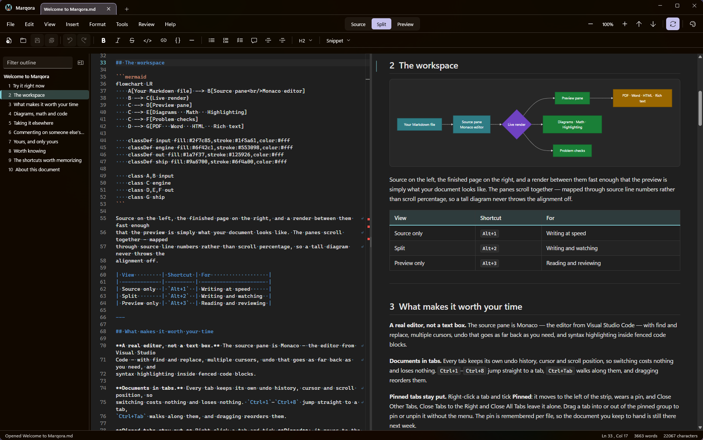

# Pictures

An input for the CLI export baseline (`tests/baselines/cli/README.md`). The other two documents
in the set carry no picture on disk, so this one exists to give the Folio something to collect,
keep in place, relocate and reduce, and the HTML and Word exports something to embed.

## A wide screenshot

1888 pixels wide: wider than the 1600 the Folio's "Shrink images wider than" offers by default,
so a shrunk Folio carries a smaller copy and an ordinary one the original.

## A small one

Both live outside this document's folder, so a Folio has to move them in beside it.

## A picture beside the document

In a folder below this document's own, so a Folio keeps its path as written and moves nothing.

## One that is missing

The export report names it, and the HTML and the PDF show the alt text where it would be.
